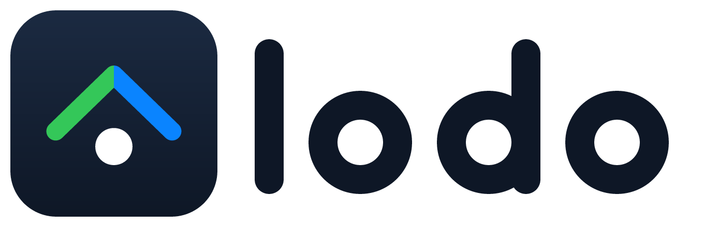

# Logo lodo



**Makna:** atap rumah dari dua jalur, hijau untuk jaringan rumah dan biru untuk VPN, di atas satu titik putih, yaitu satu alamat. Di mana pun kamu berada, alamatnya tetap satu.

| File | Untuk |
|---|---|
| `lodo-mark.svg` | ikon saja (kotak membulat, full-bleed) |
| `lodo-app-icon.svg` | ikon aplikasi dengan jarak tepi standar desktop. Sumber `crates/lodo-app/icons/*.png` |
| `lodo-logo.svg` / `.png` | ikon + tulisan, untuk latar terang |
| `lodo-logo-dark.svg` / `.png` | ikon + tulisan, untuk latar gelap |
| `lodo-wordmark.svg` | tulisan "lodo" saja |
| `lodo-logo.vectorcraft` | file sumber yang bisa diedit di VectorCraft |

**Warna:** hijau `#34C759`, biru `#0A84FF`, latar `#1B2A41` ke `#0E1726`, titik `#FFFFFF`.

## Hak cipta

Logo ini dibuat orisinal untuk lodo dari bentuk geometri dasar: garis, lingkaran, dan kotak membulat. Logo ini **tidak memakai font, ikon, atau aset pihak ketiga** apa pun. Tulisan "lodo" juga digambar dari garis dan lingkaran, bukan dari font. Jadi tidak ada lisensi pihak lain yang mengikat.

Logo dirilis dengan lisensi yang sama dengan kode lodo: [MIT](../../LICENSE).

Membuat ulang PNG dari SVG (butuh `brew install vectorcraft-cli`):

```bash
cd assets/logo
for n in 32 128 256 512; do vectorcraft-cli convert lodo-app-icon.svg ../../crates/lodo-app/icons/icon-$n.png --scale $(python3 -c "print($n/512)"); done
vectorcraft-cli convert lodo-logo.svg lodo-logo.png --scale 2
vectorcraft-cli convert lodo-logo-dark.svg lodo-logo-dark.png --scale 2
```
